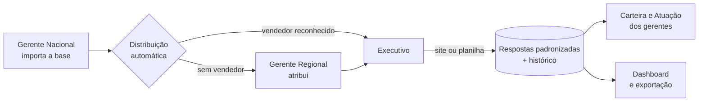
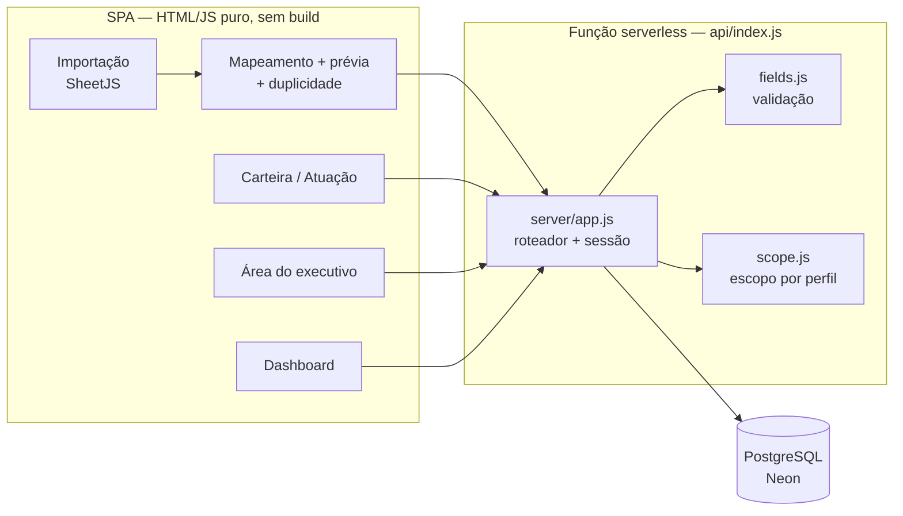
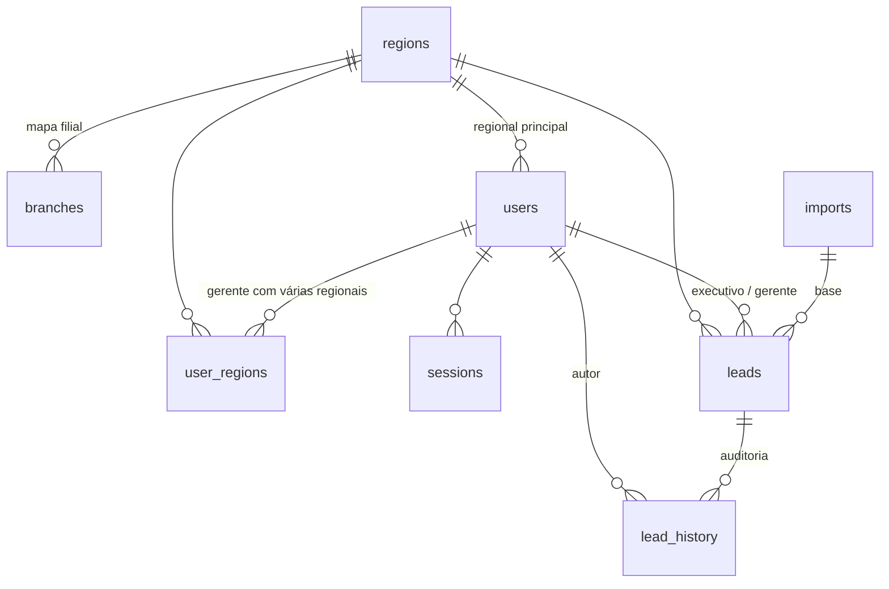

# Recupera CRM

**Mini-CRM para recuperar oportunidades de venda perdidas**, com distribuição automática da carteira, área de trabalho padronizada para a equipe comercial, planilha de ida e volta, detecção de duplicidade e dashboard em tempo real.

Pensado para um cenário comum no varejo de máquinas e equipamentos:
- uma **distribuidora** perde negócios por crédito negado, condições de pagamento ou taxa alta;
- uma **empresa parceira** tenta recuperar esses clientes oferecendo **consórcio** como alternativa de compra.

> **Autoria:** idealizado e desenvolvido por **Leonardo** — [@LeonardoBonatti](https://github.com/LeonardoBonatti), com apoio do Claude Code (Anthropic).
>
> Esta é a versão genérica, para portfólio, de um sistema em uso real. Nomes de empresas, pessoas, dados de clientes e credenciais foram removidos. Nenhum dado real faz parte deste repositório.

---

## Sumário

1. [O problema](#1-o-problema)
2. [A solução](#2-a-solução)
3. [Funcionalidades em detalhe](#3-funcionalidades-em-detalhe)
4. [Perfis e permissões](#4-perfis-e-permissões)
5. [Fluxo de trabalho](#5-fluxo-de-trabalho)
6. [Regras de negócio](#6-regras-de-negócio)
7. [Arquitetura](#7-arquitetura)
8. [Modelo de dados](#8-modelo-de-dados)
9. [API](#9-api)
10. [Segurança](#10-segurança)
11. [Como executar](#11-como-executar)
12. [Variáveis de ambiente](#12-variáveis-de-ambiente)
13. [Estrutura do projeto](#13-estrutura-do-projeto)
14. [Como adaptar a outro negócio](#14-como-adaptar-a-outro-negócio)
15. [Limitações e próximos passos](#15-limitações-e-próximos-passos)
16. [Uso e licença](#16-uso-e-licença)

---

## 1. O problema

Antes do sistema, o fluxo era todo em planilhas:

```
Distribuidora ──planilha──▶ Gerente Nacional ──▶ Gerentes Regionais ──▶ Executivos
      ▲                                                                     │
      └───────────────── planilha preenchida volta pelo mesmo caminho ◀─────┘
```

- **Perda de dados:** várias versões do mesmo arquivo, linhas apagadas, respostas sobrescritas.
- **Despadronização:** cada executivo escrevia o retorno do seu jeito ("sem int.", "nao quer", "s/ interesse"), o que tornava os números impossíveis de consolidar.
- **Falta de visibilidade:** o gerente só sabia o andamento quando a planilha voltava.
- **Retrabalho:** no fim do mês, tudo era consolidado à mão em uma apresentação.

## 2. A solução

Uma aplicação web única, acessada por navegador, em que:

1. o Gerente Nacional **importa a base uma vez**, e o sistema entrega cada oportunidade ao gerente e ao executivo responsáveis;
2. cada executivo trabalha **somente a própria carteira**, com respostas **fechadas** (opções pré-definidas) e um único campo de texto livre;
3. gerentes acompanham **em tempo real** o que cada executivo fez;
4. o **dashboard** calcula sozinho os indicadores que antes iam para a apresentação.

## 3. Funcionalidades em detalhe

### 3.1 Importação da planilha base
- Lê `.xlsx`, `.xls`, `.xlsm` e `.csv` **no navegador**, com [SheetJS](https://sheetjs.com). O CSV com `;` do Excel brasileiro é lido como texto, para não perder acentos nem zeros à esquerda.
- **Detecta a linha de cabeçalho** e **sugere o mapeamento** de cada coluna para os campos do sistema, por sinônimos ("Preço Total", "Valor total" e "Valor" viram *valor da oportunidade*). O usuário pode ajustar.
- **Prévia antes de gravar:** quantas oportunidades vão para cada regional, quantas são novas e quantas são duplicadas.
- Envio em **lotes de 300 linhas**, por causa do limite de 4,5 MB por requisição em funções serverless, com barra de progresso.
- **A linha original inteira é guardada** (`raw_data`), inclusive as colunas não mapeadas. Nada da planilha se perde.
- Respostas de rodadas anteriores que já vêm na planilha entram quando batem com as opções oficiais. As que não batem ficam guardadas e aparecem para o executivo como dica ("Planilha anterior: …").
- **Histórico de bases importadas**, com exclusão segura: só é possível excluir uma base se nenhum executivo tiver trabalhado nela.

### 3.2 Distribuição automática
- Cada linha vai para o **executivo** da coluna de vendedor e para o **gerente** da coluna de gerente.
- **Reconhecimento de nomes tolerante a grafia** (`server/match.js`), em ordem:
  1. nome ou apelido idêntico (sem acento, maiúsculas ou pontuação);
  2. diferença de até 2 letras (distância de Levenshtein);
  3. mesmo primeiro e último nome.

  Só atribui quando há **um único candidato**. Nomes não reconhecidos aparecem no resumo da importação, em vez de serem atribuídos por palpite.
- **Regional** (para relatórios e para leads sem gerente): mapa *Filial → Regional* cadastrado → coluna Regional → regional padrão escolhida na importação → "Sem regional".

### 3.3 Detecção de oportunidades duplicadas
Cada oportunidade recebe uma **impressão digital** (`server/normalize.js → opportunityKey`):

```
CNPJ/CPF (ou nome, se não houver documento válido) | equipamento | quantidade | valor total | filial
```

A formatação não interfere: `R$ 570.000,00` = `570000`, `50.121.595/0002-92` = `50121595000292`, e maiúsculas e acentos são ignorados. Só é duplicada quando **os 5 itens são iguais**.

| Situação | O que acontece |
|---|---|
| Já existe de uma base anterior | A original é mantida, com o trabalho do executivo, e ganha no histórico "reapareceu em nova base" |
| Cópias repetidas na mesma planilha | Entra só a de **resposta mais avançada** (status final > em andamento > tentativa > vazio). As respostas das demais vão para o histórico |
| Cópia repetida entre lotes do mesmo upload | Se a nova tem resposta melhor e ninguém mexeu na original, a original recebe essas respostas |

A prévia lista cada duplicada, com a linha da planilha e o motivo. Há uma opção explícita para importar mesmo assim.

### 3.4 Área de trabalho do executivo
- Lista de clientes com abas **Pendentes / Concluídos / Todos**, busca e progresso pessoal ("X de Y concluídos").
- Ficha do cliente com todos os dados da oportunidade.
- Formulário com **botões e listas fechadas** e um único campo de texto livre, o resumo do contato.
- Checklist "Para concluir", **Salvar** e **Salvar e ir para o próximo**.
- Aviso quando o cliente já apareceu em uma base anterior.
- Histórico de alterações do cliente.

### 3.5 Planilha do vendedor (ida e volta)
- **Gerar:** um `.xlsx` por executivo, com as abas *Clientes* (coluna **ID**, dados da oportunidade e colunas de retorno já preenchidas com o que está no sistema), *Lista* (opções permitidas) e *Instruções*.
- **Enviar de volta:** o sistema localiza cada linha pelo **ID**. Sem ID, usa CNPJ/CPF + equipamento, quando há um único lead assim na carteira do executivo.
- **Prévia "o que vai mudar"** (de → para) antes de gravar.
- Regras de proteção:
  - só as colunas de retorno são lidas;
  - só os clientes do próprio executivo são atualizados;
  - **nunca cria oportunidade nova**;
  - **célula em branco não apaga nada**;
  - valor fora da lista é recusado, com aviso da linha;
  - cliente repetido na planilha só vale na primeira linha.

### 3.6 Carteira (gerentes)
- Tabela com as respostas de cada cliente, a data e o autor da última atualização e a situação (Pendente / Em andamento / Concluído).
- Filtros por base, regional, situação (incluindo **"Sem atuação do vendedor"**), executivo e busca. Ordenação por valor ou por atualização mais recente.
- Ações em lote: **atribuir**, **remover atribuição**, **mover de regional** e **devolver ao nacional**.
- Ficha completa com a linha original da planilha e o histórico.

### 3.7 Atuação da equipe
- Por executivo: clientes, % trabalhados, **nunca tocados**, % concluídos, atualizações em 7 e 30 dias, **última atuação** e **último acesso**.
- Semáforo: ativo, parado há X dias ou nunca atuou.
- Linha do tempo de cada executivo, agrupada por dia: cliente, campo, valor anterior e novo.

### 3.8 Dashboard
- **Indicadores:** clientes únicos (por CNPJ/CPF), total de máquinas, valor em oportunidades (formato "R$ 294,6 mi") e ticket médio.
- **Funil:** atribuídos → contatados → concluídos → cotas fechadas, em quantidade e valor.
- **Concentração por regional:** por valor, clientes ou máquinas.
- **Distribuições:** status do contato, retorno comercial, Sim/Não/Não sabe, os 8 principais motivos da perda e desempenho por executivo.
- Atualização automática a cada 30 s.
- **Exportar Excel** (Resumo + Base consolidada) e versão para impressão em PDF.

### 3.9 Gestão de acessos
- Login por e-mail.
- **Criação de login para nova contratação**, com senha temporária e mensagem pronta para enviar.
- **Gerar acesso** para quem não recebeu ou esqueceu a senha.
- Desativar e reativar: o acesso é cortado na hora e o histórico é preservado.
- Gerente regional com **mais de uma regional**.
- Apelidos ("nome como aparece na planilha") editáveis na tela.
- Cadastro de regionais e do mapa *Filial → Regional*.

## 4. Perfis e permissões

| Ação | Gerente Nacional | Gerente Regional | Executivo | Visualizador |
|---|:-:|:-:|:-:|:-:|
| Importar e excluir bases | ✅ | — | — | — |
| Ver clientes | todos | os que gerencia | só os próprios | todos (leitura) |
| Atribuir / remover atribuição | ✅ | ✅ (executivos dele) | — | — |
| Mover de regional | ✅ | devolver ao nacional | — | — |
| Registrar retorno do cliente | — | — | ✅ | — |
| Gerar planilha por vendedor | ✅ | ✅ | a própria | — |
| Enviar planilha preenchida | — | — | ✅ | — |
| Atuação da equipe | ✅ | ✅ (equipe dele) | — | — |
| Dashboard | geral | carteira dele | os próprios números | geral |
| Exportar Excel | ✅ | ✅ | — | ✅ |
| Criar e gerenciar logins | todos os perfis | executivos dele | — | — |
| Regionais e filiais | ✅ | — | — | — |

> **Regra de ouro:** só o executivo responsável preenche o retorno do cliente. Gerentes distribuem, acompanham e cobram, mas não alteram as respostas. Assim, a autoria de cada informação é sempre clara.

## 5. Fluxo de trabalho



| Situação do cliente | Quando |
|---|---|
| **Pendente** | Nenhum retorno registrado |
| **Em andamento** | Há retorno, mas a tratativa não terminou (tentando contato, visita agendada, em negociação) |
| **Concluído** | Os 4 campos fechados respondidos + status final + resumo com pelo menos 10 caracteres |

## 6. Regras de negócio

### Campos de retorno
| Campo | Controle | Opções |
|---|---|---|
| Estava na primeira base? | Botões | Sim · Não |
| Retorno Comercial | Lista | Não tem interesse no consórcio · Não ofertei consórcio · Tem interesse consórcio · Possui consórcio da parceira · Possui consórcio no mercado |
| Comprou Concorrente | Botões | Sim · Não · Não sabe |
| Status do Contato | Lista | Tentando contato · Visita agendada · Em negociação · Cota fechada · Sem interesse · Já consorciado na parceira · Já consorciado no mercado · Cota com parcela pendente |
| Resumo do Contato | **Único texto livre** | até 2.000 caracteres |

### Etapas do status (usadas nos indicadores)
| Etapa | Status | Conta como contatado | Encerra a tratativa |
|---|---|:-:|:-:|
| Tentativa | Tentando contato | — | — |
| Em andamento | Visita agendada, Em negociação | ✅ | — |
| Ganho | Cota fechada | ✅ | ✅ |
| Perdido | Sem interesse | ✅ | ✅ |
| Encerrado | Já consorciado (parceira/mercado), Cota com parcela pendente | ✅ | ✅ |

### Indicadores
- **Cliente único:** CNPJ/CPF com 11 ou 14 dígitos; sem documento válido, pelo nome normalizado.
- **Máquinas:** soma da quantidade (1 por linha quando não informada).
- **Valor:** soma do valor total da oportunidade.

## 7. Arquitetura



| Decisão | Motivo |
|---|---|
| **Vercel (serverless) + PostgreSQL (Neon)** | Sem servidor para manter e com custo próximo de zero no volume esperado. A função não tem disco persistente, então todo estado fica no Postgres. |
| **Uma única dependência npm (`pg`)** | Menos superfície de ataque e menos manutenção. O servidor HTTP, o roteador, o *hash* de senha e as sessões usam só a biblioteca padrão do Node. |
| **Frontend em HTML/JS puro (ES modules)** | Sem etapa de build: a pasta `public/` é publicada como está. Um helper `h()` monta o DOM. |
| **Mesmo código local e na nuvem** | `server/app.js` atende tanto a função da Vercel (`api/index.js`) quanto o servidor local (`server/index.js`). |
| **Schema automático e idempotente** | `server/setup.js` roda `CREATE/ALTER … IF NOT EXISTS` sob `pg_advisory_xact_lock` na primeira chamada de cada instância. Não há passo manual de migração. |
| **Validação no servidor** | As listas fechadas vivem em `server/fields.js`. Tela, validação, importação e dashboard leem dali. |
| **Escopo por perfil no SQL** | `server/scope.js` gera a cláusula `WHERE` de cada perfil. O filtro roda no banco, não na tela. |
| **Operações em lote** | Importação com `INSERT` de várias linhas. Atribuição e roteamento com uma única instrução (`WITH … UPDATE … INSERT INTO lead_history`). Atualização por planilha com `jsonb_to_recordset`. |
| **Consultas do dashboard em paralelo** | Cada indicador é uma consulta, disparadas juntas (`Promise.all`). |

## 8. Modelo de dados



| Tabela | Conteúdo |
|---|---|
| `regions` | Regionais (nome, ativa) |
| `branches` | Mapa *Filial → Regional* |
| `users` | Nome, e-mail (login), *hash* da senha, perfil, regional, apelidos, ativo, troca de senha pendente, último acesso |
| `user_regions` | Regionais de um gerente regional que cuida de mais de uma |
| `sessions` | *Hash* do token de sessão e validade |
| `login_attempts` | Controle de tentativas de login (bloqueio temporário) |
| `app_settings` | Marcadores de tarefas executadas uma única vez |
| `imports` | Cada base importada (nome, arquivo, autor, data, total) |
| `leads` | Oportunidade: cliente, documento, filial, regional, equipamento, quantidade, valor, motivo; executivo e gerente; respostas; linha original (`jsonb`); impressão digital (`dedup_key`); datas de conclusão e atualização |
| `lead_history` | Auditoria: lead, autor, ação, campo, valor anterior, valor novo, data |

## 9. API

Todas as rotas ficam sob `/api`, recebem e devolvem JSON e exigem sessão, exceto o login. A permissão de cada rota é checada no servidor.

| Método | Rota | Descrição | Perfis |
|---|---|---|---|
| POST | `/api/auth/login` | Entrar (e-mail + senha) | público |
| POST | `/api/auth/logout` | Sair | logado |
| GET | `/api/auth/me` | Usuário da sessão | logado |
| POST | `/api/auth/password` | Trocar a própria senha | logado |
| GET | `/api/meta` | Campos, opções, perfis e etapas | logado |
| GET / POST | `/api/regions` | Listar / criar regional | logado / Nacional |
| PUT | `/api/regions/:id` | Renomear ou ativar/desativar | Nacional |
| GET / POST | `/api/branches` | Mapa Filial → Regional | Nacional |
| DELETE | `/api/branches/:id` | Remover filial do mapa | Nacional |
| GET / POST | `/api/users` | Listar / criar login | Nacional, Regional |
| PUT | `/api/users/:id` | Editar, gerar senha, desativar | Nacional, Regional |
| POST | `/api/users/initial-password` | Senha inicial para quem não acessou | Nacional |
| POST | `/api/imports` | Criar uma base | Nacional |
| POST | `/api/imports/:id/rows` | Enviar um lote de linhas (distribui e deduplica) | Nacional |
| POST | `/api/imports/check-duplicates` | Prévia de duplicidade | Nacional |
| GET | `/api/imports` | Histórico de bases | logado |
| DELETE | `/api/imports/:id` | Excluir base não trabalhada | Nacional |
| GET | `/api/leads` | Listar leads, com filtros | logado (escopo do perfil) |
| GET | `/api/leads/:id` | Ficha + linha original + histórico | logado (escopo do perfil) |
| POST | `/api/leads/assign` | Atribuir / remover em lote | Nacional, Regional |
| POST | `/api/leads/route` | Mover de regional / devolver | Nacional, Regional |
| PUT | `/api/leads/:id` | Registrar retorno | Executivo (dono) |
| POST | `/api/leads/sheet-update` | Atualizar pela planilha (com `dryRun`) | Executivo |
| GET | `/api/dashboard` | Indicadores | logado (escopo do perfil) |
| GET | `/api/export` | Base consolidada | Nacional, Regional, Visualizador |
| GET | `/api/activity` | Atuação da equipe | Nacional, Regional, Visualizador |
| GET | `/api/activity/:id` | Linha do tempo de um executivo | Nacional, Regional, Visualizador |

## 10. Segurança

| Tema | Como é tratado |
|---|---|
| Senhas | `scrypt` com *salt* aleatório por usuário e comparação em tempo constante. Nunca são gravadas nem exibidas em texto puro. |
| Primeiro acesso | Troca de senha obrigatória antes de usar o sistema. |
| Força bruta | 5 tentativas erradas → bloqueio de 5 minutos, controlado no banco (funciona entre instâncias serverless). |
| Sessão | Token aleatório de 256 bits em cookie `HttpOnly`, `SameSite=Strict` e `Secure`. Só o *hash* SHA-256 do token fica no banco. Validade de 12 h. Desativar um usuário encerra as sessões dele. |
| CSRF | A API só aceita `application/json` e o cookie é `SameSite=Strict`. |
| Autorização | Cada rota valida o perfil, e toda consulta de leads aplica o escopo do perfil no SQL. Um executivo não acessa o lead de outro nem por URL direta. |
| Integridade dos dados | O servidor recusa valores fora das listas fechadas (HTTP 400), venham da tela, da API ou da planilha. |
| Injeção de SQL | Todas as consultas usam parâmetros (`$1, $2…`). |
| Cabeçalhos | `Content-Security-Policy` restritiva, `X-Frame-Options: DENY`, `X-Content-Type-Options: nosniff` e `Referrer-Policy`. |
| Auditoria | Toda alteração relevante vai para `lead_history`, com autor e data. |
| Segredos | Nenhum no código. A conexão do banco, os usuários iniciais e a senha inicial vêm de variáveis de ambiente. |
| Dados de clientes | Nunca versionados: o `.gitignore` bloqueia planilhas, CSV, PDF, apresentações e `.env`. |

## 11. Como executar

### Na Vercel (produção)
1. Faça um fork ou importe este repositório na [Vercel](https://vercel.com) (*Add New → Project*). Não é preciso configurar build: o `vercel.json` define `public/` como site e `api/index.js` como API.
2. Em *Storage → Create Database → Neon*, crie e conecte um Postgres. A integração cria `DATABASE_URL`. Use a **mesma região** para o banco e as funções.
3. Em *Settings → Environment Variables*, defina `BOOTSTRAP_USERS` (o primeiro Gerente Nacional) e, opcionalmente, `ADMIN_PASSWORD`. Veja a seção 12.
4. Faça o deploy. No primeiro acesso, tabelas, regionais e usuários iniciais são criados automaticamente.

### Localmente
Pré-requisito: **Node.js 22.9 ou mais novo** e um Postgres (por exemplo, uma *branch* gratuita do Neon).

```bash
cp .env.example .env
```

```bash
npm install
```

```bash
npm run dev
```

Abra `http://localhost:3000`. Para só preparar o banco: `npm run db:setup`.

## 12. Variáveis de ambiente

| Variável | Obrigatória | Descrição |
|---|:-:|---|
| `DATABASE_URL` | ✅ | Conexão Postgres (*pooled*). Também aceita `POSTGRES_URL` ou qualquer `*_DATABASE_URL` criada pela integração. |
| `BOOTSTRAP_USERS` | — | JSON com os acessos iniciais: `[{"name","email","role","regions"/"region","aliases"}]`. Só cria quem ainda não existe. |
| `ADMIN_PASSWORD` | — | Senha inicial desses acessos (troca obrigatória no 1º login). Sem ela, cada acesso recebe uma senha aleatória, entregue pela tela. |
| `ADMIN_EMAIL` | — | Um Gerente Nacional extra. |
| `SEED_REGIONS` | — | Regionais criadas no primeiro uso (padrão: `Centro-Oeste,Leste,Nordeste,Norte,Sudeste`). |
| `PORT` | — | Porta do servidor local (padrão `3000`). |
| `COOKIE_SECURE` | — | `1` para cookie `Secure` fora da Vercel (atrás de HTTPS). |

Exemplos completos estão em [`.env.example`](.env.example), só com valores fictícios.

## 13. Estrutura do projeto

```
├── api/
│   └── index.js            função serverless da Vercel (delega para server/app.js)
├── public/                 frontend publicado como está
│   ├── index.html
│   ├── css/app.css         tema claro/escuro, responsivo, impressão
│   └── js/
│       ├── app.js          navegação por perfil
│       ├── lib.js          DOM, API, formatação pt-BR, modal, toast
│       ├── sheet.js        planilha do vendedor (gerar e ler)
│       └── views/          login, importar, carteira, executivo, dashboard, equipe, atuacao
├── server/
│   ├── app.js              tratador da API (roteador, sessão, erros)
│   ├── index.js            servidor local de desenvolvimento
│   ├── http.js             roteador mínimo e utilidades HTTP
│   ├── db.js               pool Postgres, transações, auditoria
│   ├── setup.js            schema, evoluções e carga inicial (idempotente)
│   ├── auth.js             senhas, sessões, limite de tentativas
│   ├── bootstrap-users.js  leitura de BOOTSTRAP_USERS
│   ├── fields.js           ★ campos, opções, etapas e sinônimos de colunas
│   ├── normalize.js        valores pt-BR, datas, CNPJ, impressão digital
│   ├── match.js            reconhecimento de nomes
│   ├── scope.js            escopo de dados por perfil
│   └── routes/             admin, leads, dashboard, activity
├── scripts/setup.js        npm run db:setup
├── .env.example            variáveis com valores fictícios
├── vercel.json             rotas e cabeçalhos de segurança
└── package.json            única dependência: pg
```

## 14. Como adaptar a outro negócio

- **Campos e opções:** edite `server/fields.js`. Rótulos, opções fechadas, etapas do status e sinônimos de colunas da planilha ficam todos ali. Tela, validação, importação e dashboard se ajustam sozinhos.
- **Regionais:** `SEED_REGIONS` no primeiro uso. Depois, pela tela.
- **Regra de duplicidade:** `opportunityKey` em `server/normalize.js`.
- **Visual:** variáveis de cor em `public/css/app.css` (`--brand`, superfícies, tema escuro).

## 15. Limitações e próximos passos

- Login por senha local. SSO (Azure AD / Google Workspace) seria o próximo passo natural em ambiente corporativo.
- Não envia notificações por e-mail ao executivo quando ele recebe leads.
- A leitura de Excel usa o SheetJS via CDN. Em redes que bloqueiam CDNs, é possível servir o arquivo localmente (`public/vendor/`).
- Não há testes automatizados nesta versão.

## 16. Uso e licença

Código disponibilizado **para consulta e portfólio**. Todos os direitos reservados ao autor. Para reutilizar ou adaptar, entre em contato pelo GitHub: [@LeonardoBonatti](https://github.com/LeonardoBonatti).
